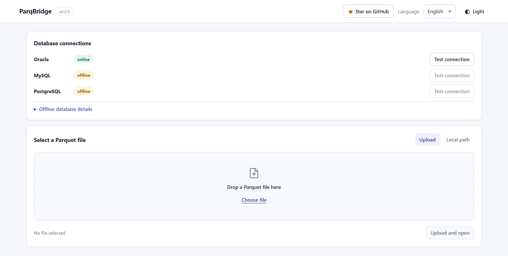
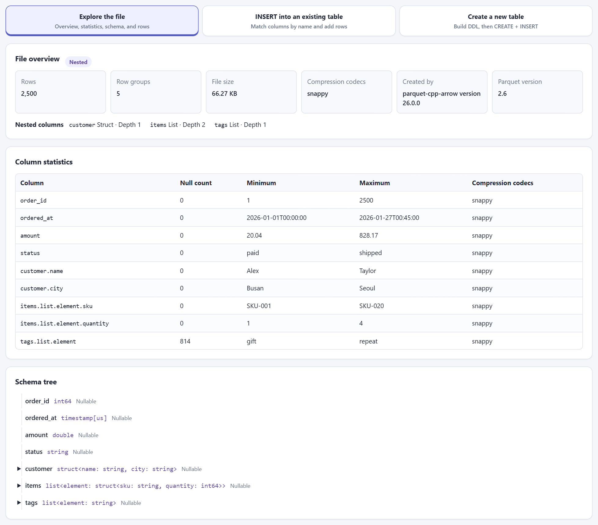
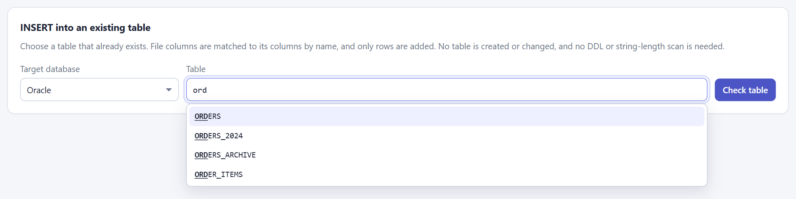
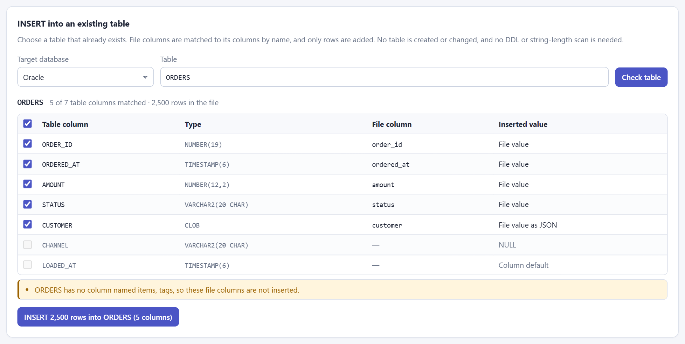
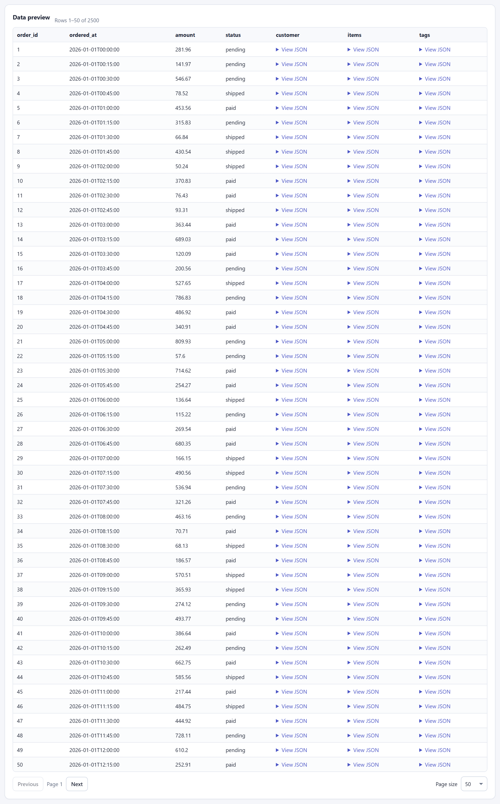
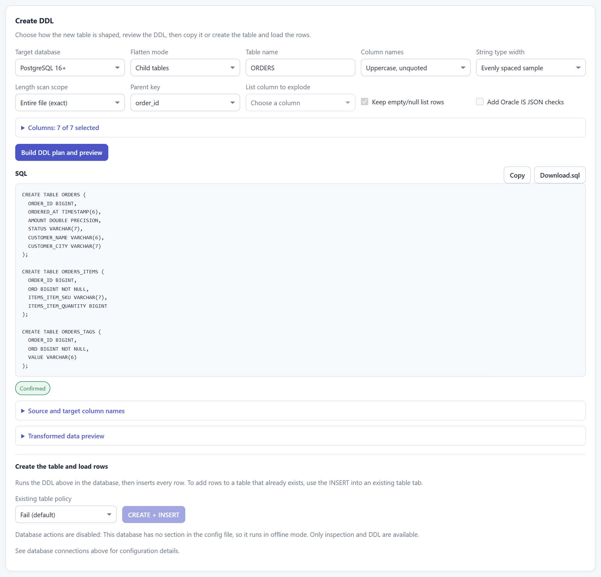

English | [한국어](README.ko.md)

# ParqBridge

[](https://github.com/Seohd99/ParqBridge/actions/workflows/ci.yml)

## When should you use ParqBridge?

- Convert Parquet files into Oracle, PostgreSQL, or MySQL tables
- Generate SQL `CREATE TABLE` statements without manually mapping Parquet types
- Load nested Parquet data into relational tables
- Inspect Parquet files locally without a separate data platform

## Overview

ParqBridge is a local web tool for inspecting the schema and data in one Parquet file and generating DDL for Oracle (12.2+, designed around 19c), MySQL 8+, and PostgreSQL 16+. When a database profile is configured, you can also test the connection, create a table, load rows in batches, and compare row counts after loading. It runs on FastAPI and vanilla JavaScript with no build chain. The web interface follows the system light/dark preference and includes a saved theme toggle.

For the current architecture and design constraints, see [Design](docs/DESIGN.md).

The default server address is `http://127.0.0.1:8765`. If a database profile is missing or incomplete, the app runs in offline mode, where inspection and DDL generation remain available.

## Screenshots

Sample data: a generated 2,500-row `orders.parquet` with struct and list columns. The INSERT screenshots use a demo Oracle table `ORDERS`.

| Select a file | Explore the file: schema and statistics |
|---|---|
|  |  |
| **INSERT into an existing table: search tables** | **INSERT into an existing table: column match** |
|  |  |
| **Preview data** | **Create a new table: DDL (PostgreSQL, child tables)** |
|  |  |

## Requirements

- Desktop use verified on Windows 10/11; automated tests run on Windows and Ubuntu
- Python 3.14 (installed automatically by uv if it is missing)
- A project-specific `.venv`
- Dependencies pinned in `pyproject.toml` and locked in `uv.lock`
- Connection details for Oracle 12.2+, MySQL 8+, or PostgreSQL 16+ if you want to load data into a database

Ubuntu automated test results are available in CI. Desktop browser use on Linux and execution on macOS have not been verified.

## Installation

### Recommended: uv

[uv](https://docs.astral.sh/uv/) prepares Python 3.14, the project `.venv`, and the locked dependencies in one step. Install uv once by following its [installation guide](https://docs.astral.sh/uv/getting-started/installation/), for example:

PowerShell:

```powershell
powershell -ExecutionPolicy ByPass -c "irm https://astral.sh/uv/install.ps1 | iex"
```

macOS/Linux (bash):

```bash
curl -LsSf https://astral.sh/uv/install.sh | sh
```

Then clone the repository and start the app from the repository root:

```bash
git clone "https://github.com/Seohd99/ParqBridge.git"
cd ParqBridge
uv run --no-dev parqbridge
```

On the first run, uv downloads Python 3.14 if no matching interpreter is found (`.python-version`), creates `.venv`, installs the versions recorded in `uv.lock`, and starts the web server at `127.0.0.1:8765`. Later runs reuse the environment. `--no-dev` leaves out the test-only packages. No configuration file is required to start; see [Configuration](#configuration) for local folders and databases.

To run the unit tests, omit `--no-dev` so the `dev` dependency group is installed:

```bash
uv run pytest -q -rs
```

uv installs ParqBridge in editable mode, so configuration and uploads still resolve under the repository's `config/` and `workspace/` folders. Do not use `--no-editable`.

### Alternative: pip

If you already manage Python 3.14 yourself, prepare the virtual environment and dependencies with pip. `requirements.txt` is generated from `uv.lock` and includes the test packages.

PowerShell:

```powershell
git clone "https://github.com/Seohd99/ParqBridge.git"
Set-Location ParqBridge
py -3.14 -m venv .venv
.\.venv\Scripts\python.exe -m pip install --upgrade pip
.\.venv\Scripts\python.exe -m pip install -r requirements.txt
```

macOS/Linux (bash):

```bash
git clone "https://github.com/Seohd99/ParqBridge.git"
cd ParqBridge
python3.14 -m venv .venv
.venv/bin/python -m pip install --upgrade pip
.venv/bin/python -m pip install -r requirements.txt
```

Run the dependency check and unit tests from the repository root with the pip-managed environment.

PowerShell:

```powershell
$python = ".\.venv\Scripts\python.exe"
& $python -c "import fastapi, pyarrow, duckdb, oracledb, pymysql, psycopg; print('dependencies ready')"
& $python -m pytest -q -rs
```

macOS/Linux (bash):

```bash
.venv/bin/python -c 'import fastapi, pyarrow, duckdb, oracledb, pymysql, psycopg; print("dependencies ready")'
.venv/bin/python -m pytest -q -rs
```

## Configuration

A configuration file is optional. Without one, the app starts with default settings: every database stays offline, uploaded Parquet files can be inspected and turned into DDL, and local-path selection is unavailable because no allowed roots are configured.

To select local files or configure databases, copy the example file to create a local configuration file. The actual configuration file is ignored by git.

```powershell
Copy-Item config\parqbridge.example.toml config\parqbridge.toml
```

macOS/Linux (bash):

```bash
cp config/parqbridge.example.toml config/parqbridge.toml
```

To select a local Parquet path, set an allowed root in `[server]` to the folder containing the file. The app only lists paths under this root and does not copy or modify the selected file.

```toml
[server]
host = "127.0.0.1"
port = 8765
upload_max_mb = 2048
allowed_roots = ["D:\\data"]
# macOS/Linux example: allowed_roots = ["/home/me/data"]

[load]
batch_size = 10000
child_max_depth = 3
```

When using a database, fill in the relevant section with actual values. We recommend storing the password in the environment variable named by `password_env`.

```toml
[db.oracle]
host = "db.example.local"
port = 1521
service_name = "ORCLPDB1"
user = "parqbridge_user"
password_env = "PARQBRIDGE_ORACLE_PASSWORD"

[db.mysql]
host = "db.example.local"
port = 3306
database = "parqbridge"
user = "parqbridge_user"
password_env = "PARQBRIDGE_MYSQL_PASSWORD"

[db.postgres]
host = "db.example.local"
port = 5432                    # Default: 5432
database = "parqbridge"
schema = "public"              # Optional
user = "parqbridge_user"
password_env = "PARQBRIDGE_POSTGRES_PASSWORD"
```

Here is an example of setting an environment variable in the current shell session. Read the password at a prompt so it is not entered directly into command history.

PowerShell:

```powershell
$secure = Read-Host "Oracle password" -AsSecureString
$env:PARQBRIDGE_ORACLE_PASSWORD = [System.Net.NetworkCredential]::new("", $secure).Password
```

macOS/Linux (bash):

```bash
read -r -s -p "Oracle password: " PARQBRIDGE_ORACLE_PASSWORD
printf '\n'
export PARQBRIDGE_ORACLE_PASSWORD
```

Set `PARQBRIDGE_MYSQL_PASSWORD` for MySQL and `PARQBRIDGE_POSTGRES_PASSWORD` for PostgreSQL in the same way. If you store a password in a file instead of an environment variable, put `password = "..."` in the corresponding `[db.<kind>]` section of `config/parqbridge.local.toml`. This file is also ignored by git. The `password` value in the main `parqbridge.toml` is ignored and a warning is shown.

To use a different configuration file, set an environment variable before starting the server.

```powershell
$env:PARQBRIDGE_CONFIG = "C:\path\to\parqbridge.toml"
```

macOS/Linux (bash):

```bash
export PARQBRIDGE_CONFIG="/path/to/parqbridge.toml"
```

`config/parqbridge.local.toml` is merged over the default configuration file. If a database section or a required value or password is missing, only that database is offline, and the app shows the reason and configuration guidance.

## Run

Start the app using the host and port in the configuration. The default is `127.0.0.1:8765`.

With uv:

```bash
uv run --no-dev parqbridge
```

With a pip-managed environment, PowerShell:

```powershell
.\.venv\Scripts\python.exe -m app
.\.venv\Scripts\python.exe -m uvicorn app.main:app
```

macOS/Linux (bash):

```bash
.venv/bin/python -m app
.venv/bin/python -m uvicorn app.main:app
```

Running Uvicorn directly uses its default address, `127.0.0.1:8000`.

Open the server address in a browser and choose a language with the selector. A saved choice takes priority; otherwise the UI uses the first supported browser language and defaults to English. The selector and browser-language matching use the catalogs in `app/i18n/`; a language chosen with the selector is saved in browser `localStorage`.

### Adding a language

Add `app/i18n/<code>.json` with the same message keys and placeholders as the existing catalogs, plus `"meta": {"native_name": "日本語"}` (use that language's native name). The web selector, browser-language matching, and CLI `--lang` choices discover catalogs from their filenames. Run the test suite to check catalog keys and placeholders.

## CLI

`python -m app` and `parqbridge` with no subcommand start the web server. Run command-line tasks with the Python interpreter in `.venv`, or with `uv run --no-dev parqbridge <command>`; the input Parquet path must be under `[server].allowed_roots` in the configuration. The file is opened read-only at its original location.

uv:

```bash
uv run --no-dev parqbridge --help
uv run --no-dev parqbridge inspect "D:\data\part.parquet"
uv run --no-dev parqbridge ddl "D:\data\part.parquet" --dialect oracle --mode none --table PB_TEST_PART -o part.sql
```

The examples below use a pip-managed environment; each `-m app` form also works as `uv run --no-dev parqbridge`.

PowerShell:

```powershell
$python = ".\.venv\Scripts\python.exe"
& $python -m app --help
& $python -m app inspect "D:\data\part.parquet"
& $python -m app inspect "D:\data\part.parquet" --json
& $python -m app preview "D:\data\part.parquet" --offset 100 --limit 25
& $python -m app preview "D:\data\part.parquet" --json
& $python -m app ddl "D:\data\part.parquet" --dialect oracle --mode none --table PB_TEST_PART -o part.sql
& $python -m app load "D:\data\part.parquet" --dialect mysql --table PB_TEST_PART --batch-size 1000
& $python -m app load "D:\data\2025.parquet" --dialect mysql --table PB_TEST_PART --column id --column name --insert-only
& $python -m app config check
```

macOS/Linux (bash):

```bash
python=.venv/bin/python
"$python" -m app --help
"$python" -m app inspect "/home/me/data/part.parquet"
"$python" -m app inspect "/home/me/data/part.parquet" --json
"$python" -m app preview "/home/me/data/part.parquet" --offset 100 --limit 25
"$python" -m app preview "/home/me/data/part.parquet" --json
"$python" -m app ddl "/home/me/data/part.parquet" --dialect oracle --mode none --table PB_TEST_PART -o part.sql
"$python" -m app load "/home/me/data/part.parquet" --dialect mysql --table PB_TEST_PART --batch-size 1000
"$python" -m app load "/home/me/data/2025.parquet" --dialect mysql --table PB_TEST_PART --column id --column name --insert-only
"$python" -m app config check
```

The dialect choices for `ddl` and `load` come from the currently supported dialects. Add `--lang <code>` after each command to choose an output language from the catalogs in `app/i18n/`; an explicit value overrides the default. Without it, the CLI checks `PARQBRIDGE_LANG`, then `LC_ALL`, `LC_MESSAGES`, and `LANG`; Windows also checks the system locale and UI language. Supported locale preferences select their matching catalog, while unsupported or missing preferences default to English. The `truncate` or `drop_create` policy for `load` requires a `--confirm-table` value that matches the target parent table name. Ctrl+C cancels loading at a batch boundary and the result reports rows that were already committed. Exit codes are success `0`, failure `1`, confirmation denied `2`, and cancelled `130`. The CLI does not accept database passwords as arguments; it uses the existing `password_env` or `config/parqbridge.local.toml` setting.

`ddl -o` rejects the input Parquet file and any Parquet file as an output target. Specify `--force` to replace an existing output file. `ddl` and `load` support `--length-scan full|sample` to choose the length measurement scope; the default is `full`. Repeat `--column NAME` to include only those top-level columns; without it, every column is included. `load --insert-only` inserts into the existing `--table` without `CREATE`, matching file columns to table columns by name; it cannot be combined with `--if-exists`, `--mode child|explode`, `--parent-key`, or `--explode-column`.

uv provides the `parqbridge` command automatically. In a pip-managed environment, you can install it as an optional step after installing the dependencies. Keep the install editable (`-e`) so configuration and uploads resolve under the repository; a non-editable `pip install .` is not supported.

```powershell
.\.venv\Scripts\python.exe -m pip install -e .
```

## Usage flow

1. Choose or drop a `.parquet` file in the Upload tab, then click **Upload and open** (enabled after selecting a file). Alternatively, browse an allowed folder in the Local path tab.
2. Pick a task tab. The choice is remembered in this browser.
   - **Explore the file**: review the metadata, column statistics, schema, flat/nested classification, and paged row preview.
   - **INSERT into an existing table**: choose the target database and table (table names in the current schema are fetched once and filtered as you type), click **Check table**, review how file columns match table columns, and run INSERT. No DDL is generated and no string-length scan is awaited. See [INSERT into an existing table](#insert-into-an-existing-table).
   - **Create a new table**: choose the flattening mode, target database, table name, and column options to generate DDL and preview the transformed data. All top-level columns are included by default; uncheck columns under **Columns** to leave them out of the DDL, CREATE, and INSERT. Copy the DDL, download it as a `.sql` file, or, if the database is online, run `CREATE + INSERT` with an existing-table policy below.
3. Follow the progress. When the job finishes, compare the source or expected transformed row count with the database `COUNT(*)` result.

The suggested table name follows the selected database's naming rules and updates when you change the target database. A name you edit yourself is kept until you select another file.

The main API endpoints are `GET /api/status`, `GET /api/files/browse`, `POST /api/files/local`, `POST /api/files/upload`, `GET /api/files/{file_id}/inspect`, `GET /api/files/{file_id}/preview`, `GET /api/files/{file_id}/length-scan`, `POST /api/files/{file_id}/ddl`, `POST /api/files/{file_id}/load`, `POST /api/files/{file_id}/insert/check`, `POST /api/files/{file_id}/insert`, `GET /api/db/{dialect}/tables`, `POST /api/files/{file_id}/release`, and `GET /api/jobs/{job_id}`. File handles and job state live in process memory, so you must select the file again after restarting the server.

## Flattening modes

The default, unchecked mode is `none`. DDL previews and load plans use the same transformation plan.

| Mode | Behavior | Example |
|---|---|---|
| `none` | Preserves list/struct/map as a single JSON value. Oracle uses `CLOB`, MySQL uses `JSON`, and PostgreSQL uses `JSONB`. | `authors: [{name: "Kim"}]` → `AUTHORS` JSON column |
| `child` | Flattens struct fields into parent columns and creates child tables for list/map values with a parent key, ordinal, and value. Nested containers beyond the depth limit remain JSON. | `author.name` → `AUTHOR_NAME`; `tags: ["a", "b"]` → parent table and `ORD` plus value rows in the `TABLE_TAGS` child table |
| `explode` | Expands one selected top-level list into rows. Other nested columns remain JSON. By default, it keeps parent rows for null/empty arrays and sets the list value to `NULL`. | `tags: ["a", "b"]` → one row per tag |

In `child` mode, you can use a selected top-level scalar column as the parent key. If you do not select one, the app generates `_PB_ROW_ID` from the file row number (`PB_ROW_ID` for Oracle unquoted names, which must start with a letter). Because a generated key restarts at 0 for each file, `append` with a generated key is allowed only while the target tables are empty; select a parent key column to append several files. Struct fields whose names differ only by case are not supported and are rejected with `E_SCHEMA_NAME_COLLISION`. `explode` requires selecting one list column; the preview shows the expected row count.

## Main type mapping

| Arrow type | Oracle 12.2+ (19c baseline) | MySQL 8+ | PostgreSQL 16+ |
|---|---|---|---|
| int8 | `NUMBER(3)` | `TINYINT` | `SMALLINT` |
| int16 | `NUMBER(5)` | `SMALLINT` | `SMALLINT` |
| int32 | `NUMBER(10)` | `INT` | `INTEGER` |
| int64 | `NUMBER(19)` | `BIGINT` | `BIGINT` |
| uint8/16/32/64 | `NUMBER(3/5/10/20)` | `TINYINT` / `SMALLINT` / `INT` / `BIGINT` `UNSIGNED` | `SMALLINT` / `INTEGER` / `BIGINT` / `NUMERIC(20)` |
| float32 / float64 | `BINARY_FLOAT` / `BINARY_DOUBLE` | `FLOAT` / `DOUBLE` | `REAL` / `DOUBLE PRECISION` |
| decimal(p,s) | `NUMBER(p,s)`; precision above 38 warns and uses a character type | `DECIMAL(p,s)`; precision above 65 warns and uses a character type | `NUMERIC(p,s)` |
| bool | `NUMBER(1)` | `TINYINT(1)` | `BOOLEAN` |
| string | `VARCHAR2(n CHAR)` or `CLOB` | `VARCHAR(n)`, then `TEXT` / `MEDIUMTEXT` / `LONGTEXT` depending on length | `VARCHAR(n)` for sampled lengths; `TEXT` for `max`/`lob` |
| date | `DATE` | `DATE` | `DATE` |
| time | `CLOB` (string fallback) | `LONGTEXT` (string fallback) | `TIME(p)`; warns above 6 fractional-second digits |
| timestamp / timestamp with zone | `TIMESTAMP(p)` / `TIMESTAMP(p) WITH TIME ZONE` | `DATETIME(p)`; warns when timezone values are converted to UTC | `TIMESTAMP(p)` / `TIMESTAMPTZ(p)`; warns above 6 fractional-second digits |
| binary | `RAW(n)` or `BLOB` | `VARBINARY(n)` or `LONGBLOB` | `BYTEA` |
| list/struct/map, `none` | `CLOB` (adds an `IS JSON` check if selected) | `JSON` | `JSONB` |

String and binary type widths are selected with the `sample`, `max`, and `lob` strategies; the separate `length_scan` option selects the scope used to measure lengths. The default `full` scan calculates top-level string/binary aggregates with DuckDB (up to 4 threads, with a 2 GB memory limit per connection), and reads nested list/struct/map leaves in Arrow batches of 1,024 rows per row group with up to 4 workers. Character counts use Unicode code points and byte counts use UTF-8 length. Only each column's maximum is retained, so the whole file is not loaded into memory. `sample` measures at most 512 leading rows from up to 4 evenly selected row groups across the file and adds a 20% margin. Long values later within a row group may be missed by the sample.

When a local or uploaded file is selected in the web app, a full scan starts in the background. Check its status with `GET /api/files/{file_id}/length-scan`. Before it finishes, a `full` DDL request immediately returns an estimated DDL based on a sample and the scan's progress; after the scan finishes, the app automatically reloads the confirmed DDL. A load job waits for the confirmed scan to finish and uses its measurements to create the same table model as the confirmed DDL shown on screen. The CLI measures synchronously.

A `full` scan has no margin above the current file's maximum, so a longer value from another file appended to the same table may exceed the width. Consider `max` or `lob` if you plan to append multiple files. Oracle `max` uses `VARCHAR2(1000 CHAR)` as the default width and promotes it to `CLOB` if a measured value exceeds 1,000 characters or the 4,000-byte limit. MySQL `max` chooses the necessary width among `VARCHAR(16383)`, `TEXT`, `MEDIUMTEXT`, and `LONGTEXT` based on measured values, and may be further demoted by the table row-size budget. PostgreSQL `max` and `lob` use `TEXT` with no length limit. Oracle `lob` uses `CLOB`; MySQL `lob` uses `LONGTEXT`.

## Column selection

Unchecked columns are left out of the DDL, the created tables, and the inserted rows. Because Parquet stores each column separately, a load reads only the selected columns from the file. A `child` parent key or an `explode` column must be selected. In `child` mode, leaving out a list or map column also leaves out its child table. The API accepts `columns` as a list of top-level column names; omit it or send `null` to include every column.

## INSERT into an existing table

Use the **INSERT into an existing table** tab (API `POST /api/files/{file_id}/insert`, CLI `load --insert-only`) to add a file's rows to a table that already exists, such as one more year of data. It never runs `CREATE`, `TRUNCATE`, or `DROP`, and it does not wait for the string-length scan, because the table already fixes the column types.

- The table is looked up in the profile's current Oracle schema, MySQL database, or PostgreSQL schema, ignoring letter case; an exact name wins. A missing table returns `E_INSERT_TABLE_MISSING`, and names that differ only by case without an exact match return `E_INSERT_TABLE_AMBIGUOUS`.
- Top-level file columns match table columns by name, exactly first and then ignoring case. Nested values are inserted as JSON text. Computed (virtual/generated) table columns are never matched.
- `POST /api/files/{file_id}/insert/check` with `{"dialect", "table_name"}` returns every table column with its type, matched file column, and whether it is `NOT NULL` without a default, plus file columns with no table column (`W_INSERT_FILE_COLUMNS_SKIPPED`). Unchecking matched columns, or sending `columns` with a subset of matched file column names, leaves those table columns to their default or `NULL`.
- A `NOT NULL` column without a default that gets no file value produces `W_INSERT_REQUIRED_COLUMNS` instead of an error, because a trigger may fill it; otherwise the database rejects the first batch.
- The database converts values to the existing column types, so a value that does not fit, such as a string longer than the column, fails that batch and the error reports its location.

`POST /api/files/{file_id}/load` no longer accepts `existing_policy: "insert_only"`; use the insert endpoints above. To append to a parent/child table family, use **Create a new table** with the `append` policy.

## Existing table policy

Choose a policy before `CREATE + INSERT`.

- `fail`: Reject the operation if a table with the same name exists. This is the default.
- `append`: Add rows when the existing table's column set matches the plan. With a generated `child` key, every target table must be empty.
- `truncate`: Empty the confirmed target table and load the data.
- `drop_create`: Drop the confirmed table and create it again.

For `truncate` and `drop_create`, the confirmation dialog requires you to re-enter the exact parent table name. In child mode, the dialog also lists the affected parent and child tables.

## Tests and golden files

Run the full test suite.

uv:

```bash
uv run pytest -q -rs
```

pip-managed environment, PowerShell:

```powershell
.\.venv\Scripts\python.exe -m pytest -q -rs
```

macOS/Linux (bash):

```bash
.venv/bin/python -m pytest -q -rs
```

### Continuous integration

[GitHub Actions](https://github.com/Seohd99/ParqBridge/actions/workflows/ci.yml) runs on pushes to `main`, pull requests, and manual dispatch. Unit tests run on Windows and Ubuntu with Python 3.14 and the committed `uv.lock`. Separate Ubuntu jobs start disposable PostgreSQL 16.15, MySQL 8.4.11, and Oracle Free 23.26.3 service containers. Actions and container images are pinned to commit SHAs and image digests.

Each database runs nine integration cases: create/load/count and Korean/UTC timestamp round trips; INSERT into existing tables with defaults and computed columns; JSON, child-table, and explode modes; both parent-key append policies; cancellation after a committed batch; and case-distinct column values. All tables use the `PB_TEST_` prefix and are cleaned up. CI fails if its database profile is missing rather than silently skipping tests. JUnit reports are downloadable from each workflow run's artifacts.

The Oracle job checks the Free container version listed above; it does not establish compatibility with every Oracle 12.2/19c installation. The badge links to actual run results, including failures and reruns.

To require a dedicated local test profile explicitly:

```bash
uv run pytest tests/integration -m postgres --db-config=/path/to/test.toml --require-db -q -rs
```

The explicit TOML uses the normal profile format with `password_env`; it is isolated from `config/parqbridge.local.toml`. CI creates its profile under the runner's temporary directory with `tools/ci_database_config.py` and uses public passwords only for its disposable containers.

### Changing dependencies

`pyproject.toml` is the single source of dependency pins: runtime packages are in `[project].dependencies` and test packages are in the `dev` dependency group. After changing a pin, regenerate the lock file and the pip requirements file, then run the full suite. Do not edit `uv.lock` or `requirements.txt` by hand; `tests/test_packaging.py` fails when they drift from `pyproject.toml`.

```bash
uv lock
uv export --format requirements-txt --no-hashes --no-emit-project -o requirements.txt
```

Integration tests run only when the corresponding database profile is online. Without a profile, tests marked `oracle`/`mysql`/`postgres` are skipped with a reason. When a database is used, tests create and clean up only `PB_TEST_` tables.

Run individual markers:

```powershell
.\.venv\Scripts\python.exe -m pytest -q -m oracle -rs
.\.venv\Scripts\python.exe -m pytest -q -m mysql -rs
.\.venv\Scripts\python.exe -m pytest -q -m postgres -rs
```

macOS/Linux (bash):

```bash
.venv/bin/python -m pytest -q -m oracle -rs
.venv/bin/python -m pytest -q -m mysql -rs
.venv/bin/python -m pytest -q -m postgres -rs
```

Update golden files only when intentionally changing DDL output.

```powershell
@'
import os
import pytest
os.environ["UPDATE_GOLDEN"] = "1"
raise SystemExit(pytest.main(["-q", "tests/test_ddl.py"]))
'@ | .\.venv\Scripts\python.exe -
```

macOS/Linux (bash):

```bash
UPDATE_GOLDEN=1 .venv/bin/python -m pytest -q tests/test_ddl.py
```

After updating, review changes under `tests/golden/*.sql` and run the full test suite again.

## Large-file measurements

You can select an existing file of 1 GiB or more to measure preview/inspect response times and fake-driver load RSS. The original file is opened read-only and is not copied or modified. RSS uses the peak working set from Windows `GetProcessMemoryInfo`.

The script below uses the Win32 `GetProcessMemoryInfo` API and therefore runs only on Windows.

```powershell
.\.venv\Scripts\python.exe tools\measure_large_parquet.py "D:\data\large.parquet" --batch-sizes 1000,5000,10000
```

The script outputs JSON with the selected file's size, row count and number of row groups, API first-page and 90%-offset page timings, and `execute_load` time and RSS growth for each batch size. It uses a fake MySQL connection that does not retain inserted rows instead of a database driver, so it does not measure real database load performance.

## Platform-specific code and verification notes

- Desktop app usage has been checked on Windows 10/11. CI runs automated tests on Windows and Ubuntu 24.04; Linux desktop browser use and execution on macOS have not been verified.
- RSS measurement in `tools/measure_large_parquet.py` uses Windows `psapi.GetProcessMemoryInfo`.
- Path validation uses platform path APIs and checks junctions when the Windows junction API is available. The symlink escape test in `tests/test_files.py` is skipped if the test environment does not allow symlink creation.
- Upload filename cleanup also normalizes Windows backslashes as path separators.

## Security and operations notes

- The server binds only to `127.0.0.1` by default. Do not expose it on a shared network.
- Original local Parquet files can only be selected from allowed roots and are read-only. Only uploaded files can be deleted from the upload list.
- Keep `allowed_roots` limited to the folders you need. Path traversal and links pointing outside allowed roots are blocked.
- Store passwords in environment variables or the gitignored `parqbridge.local.toml`. Do not record passwords or DSNs in logs, the UI, responses, or test fixtures.
- Restarting the server clears selected file handles and job state held in memory. Closing the browser does not stop a running load job.

## Known limitations

- Struct fields whose names differ only by case are rejected in previews and plans. MySQL also rejects case-only column-name collisions under the quoted naming policy.
- Expanding map keys into wide columns is a follow-up task. For now, use JSON in `none` mode or a map child table in `child` mode.
- `length_scan=sample` is an estimate and does not guarantee the maximum value in the whole file. If you suspect long values were missed or encounter a load error, plan again with `length_scan=full`. The exact maximum measured by a full scan does not guarantee widths for values appended from other files.
- The `LOAD DATA LOCAL INFILE` path is disabled. MySQL loading currently uses batched `executemany`.
- Database performance depends on the driver, network, schema, and server settings. Fake-driver measurements do not represent real database load speed or memory usage.
- File handles and job history shown in the UI are stored only in process memory.

## License

[MIT](LICENSE)
